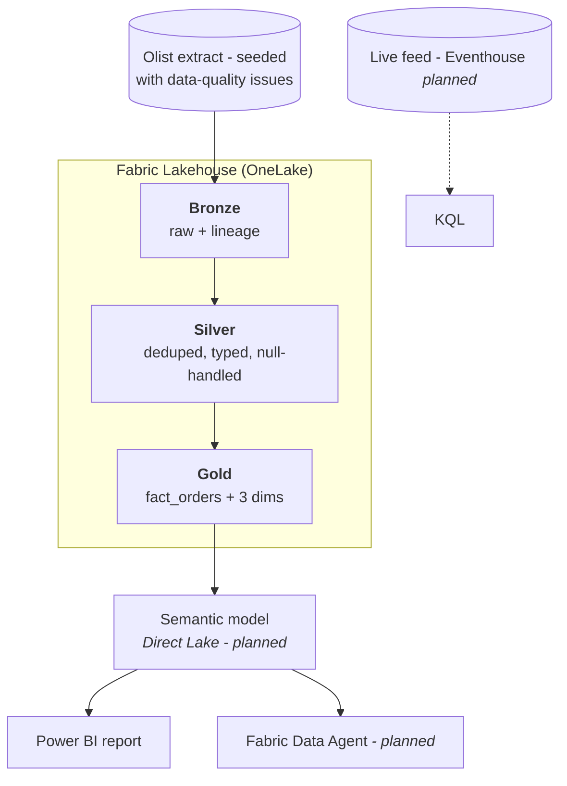

# fabric-medallion-retail-analytics

[](https://github.com/harunrhimu/fabric-medallion-retail-analytics/actions/workflows/ci.yml)

A retail sales analytics system - not a dashboard - built on Microsoft Fabric:
raw ingest → Bronze → Silver → Gold star schema → Direct Lake semantic model →
Power BI report and a Fabric Data Agent, with CI/CD over every layer.

## The business problem

A retail marketplace needs trustworthy order analytics: revenue by month and
category, customer value, delivery performance. The raw extract arrives exactly
like real vendor data does - duplicates, blank keys, unparseable timestamps,
negative amounts, schema drift. The system's job is to turn that into a star
schema a business can defend numbers with, and to prove every rule it applies.

## Architecture



Full detail, layer guarantees and decision records: [`docs/architecture.md`](docs/architecture.md).

## Results

| Measurement | Before | After |
|---|---:|---:|
| Same business query, Silver path vs Gold path | *being measured* | *being measured* |
| SQL tuning set Q1–Q4 (median of 5 runs) | *being measured* | *being measured* |

Real numbers live in [`docs/results.md`](docs/results.md) - captured during the
build, never reconstructed afterwards.

## Tradeoffs

- **One fact grain (order)** keeps the model small enough to defend in a live
  screen; item-level questions read `silver.order_items` joined to `dim_product`
  rather than a second fact.
- **Delta overwrite rebuilds** for Silver/Gold: idempotent and simple at ~100k
  rows; incremental merge is the documented next step at real scale.
- **Fabric only, no ADF/Synapse/Databricks**: Fabric covers ingest, warehouse
  and Spark in one platform - the repo says so explicitly in its docs rather
  than padding the stack with tools it does not need.
- **Synthetic-but-messy Olist data**: public, reproducible, and the defects are
  deliberately seeded so every cleansing rule has something to catch.

## Repository map

| Path | What it is |
|---|---|
| `.github/workflows/ci.yml` | CI: `ruff` → `sqlfluff` → `pytest` → TMDL validate → secret scan |
| `notebooks/` | PySpark: `00` Bronze ingest, `01` Silver cleansing, `02` Gold star, `03` benchmark |
| `sql/` | 4 before/after tuning pairs + measurement method |
| `tests/` | Data-quality rules, proven against clean + seeded-issue fixtures |
| `scripts/` | `seed_data.py` (idempotent staging + manifest), `validate_tmdl.py` (CI) |
| `docs/` | Architecture, ADRs, measured results, screenshot checklist |
| `data/` | Gitignored Olist extract - see [`data/README.md`](data/README.md) |

## Run it yourself

```bash
git clone https://github.com/harunrhimu/fabric-medallion-retail-analytics.git
cd fabric-medallion-retail-analytics
pip install -r requirements-dev.txt
ruff check . && sqlfluff lint sql && pytest   # the CI pipeline, locally
```

Then, against a Fabric trial workspace:

1. Download Olist and stage it - [`data/README.md`](data/README.md).
2. Upload `data/raw/*` to the Lakehouse `Files/raw` folder.
3. Run `notebooks/00 → 01 → 02` on a PySpark notebook attached to the Lakehouse.
4. Run `notebooks/03_benchmark.py` and paste the row into `docs/results.md`.

## Roadmap

- [x] Repo scaffold + CI green
- [x] Bronze ingest, Silver (PySpark), Gold star schema
- [x] Data-quality tests + SQL tuning set
- [ ] Semantic model (PBIP/PBIR, Direct Lake) + Power BI report
- [ ] Eventhouse / Eventstream real-time component
- [ ] Fabric Data Agent over the model
- [ ] Numbers captured, screenshots, 5-minute walkthrough video

## License

[MIT](LICENSE)
