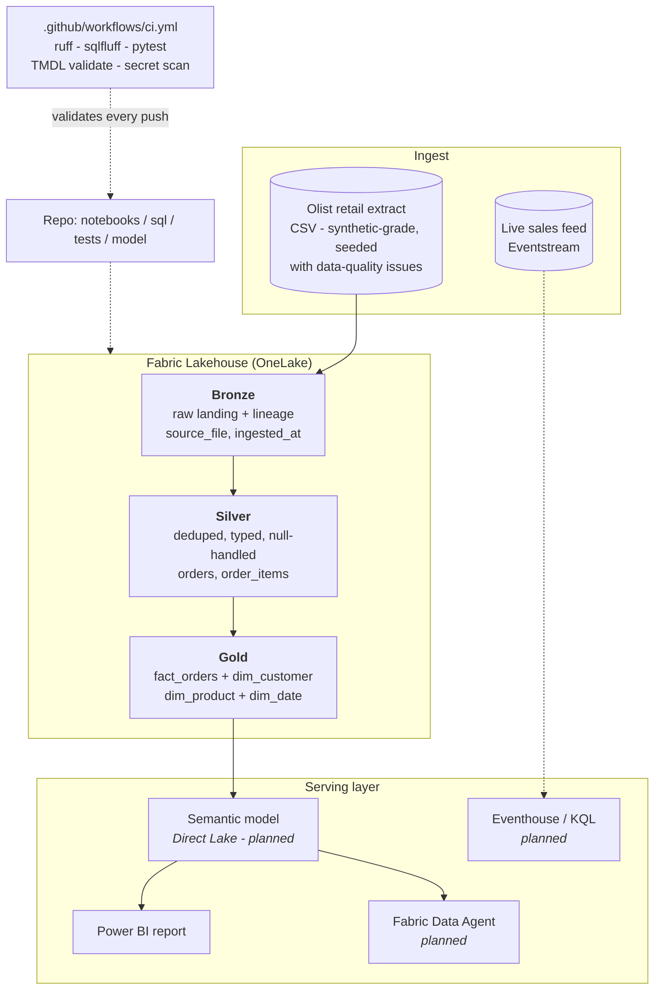

# Architecture

Retail sales analytics built as a medallion system on a Microsoft Fabric Lakehouse:
ingest → Bronze → Silver → Gold → semantic model → report / agent, with CI/CD over the whole repo.

Solid arrows = built and running. Dotted = planned in a later sprint (see Roadmap in the README).

## Layers

| Layer | Tables / items | Guarantees enforced in code |
|---|---|---|
| Bronze | `bronze.*` - one Delta table per raw CSV | Raw values untouched; only `source_file` + `ingested_at` added; rebuild is idempotent |
| Silver | `silver.orders`, `silver.order_items` | One row per business key; no blank keys; timestamps inside 2016-01-01..2019-01-01; no negative amounts (every drop counted and printed) |
| Gold | `gold.fact_orders`, `gold.dim_customer`, `gold.dim_product`, `gold.dim_date` | Fact grain = one row per order (asserted before write); every `customer_key` resolves; every `date_key` falls inside `dim_date` |
| Serving | semantic model (Direct Lake), report, KQL, data agent | *planned* |

## Why these shapes

- **`dim_date` is generated, not derived** - time intelligence never breaks because the order data changed. Decision record: [ADR-002](adr/ADR-002-separate-dim-date.md).
- **One fact grain (order).** Item-level analysis reads `silver.order_items` joined to `gold.dim_product`; a second item-grain fact is a candidate once the model ships. See `sql/04_category_revenue_*`.
- **`arrived_late` is computed in the Gold build**, not in every query - see `sql/03_late_orders_*` for what that saves.
- **Lakehouse over a standalone warehouse**: [ADR-001](adr/ADR-001-lakehouse-over-warehouse.md).

## Platform-equivalence note

This system is built entirely in Fabric: the medallion layers are Delta tables in
OneLake, transformations are PySpark notebooks, orchestration would be a Fabric
pipeline, and serving is Direct Lake. **ADF, Synapse and Databricks are deliberately
not used** - Fabric is the equivalent platform covering all three (ingest /
warehouse / Spark), which is the point of this repo.

## CI/CD contract

Every push runs `.github/workflows/ci.yml`: `ruff` on all Python, `sqlfluff`
(`tsql`) on `sql/`, `pytest` data-quality checks, TMDL parse of the semantic
model (skips until `model/` exists) and a `gitleaks` secret scan. The badge in
the README reflects the last run.
